# Leuchtturmwärter (Arbeitstitel)

Koop-Browserspiel für 2–4 Spieler: Die Crew steuert ein Schiff durch einen nebligen, nächtlichen Ozean.
Das Schiff ist ein Querschnitt mit drei Decks; man läuft zu Stationen (Steuerrad, Scheinwerfer, Pumpe,
Werkstatt, Kanone) und hält das Schiff zusammen weiter.

**Stand: Phase 1–4 sind umgesetzt** – spielbares Schiff, Look, Online-Multiplayer und Spielinhalt: Die Crew muss das
Schiff durch Sturm, Felsen im Nebel und Kraken-Angriffe bis zum Leuchtturm bringen. 2–4 Geräte spielen über einen
Raumcode zusammen; allein üben geht ohne Server. Mit Platzhalter-Sounds.

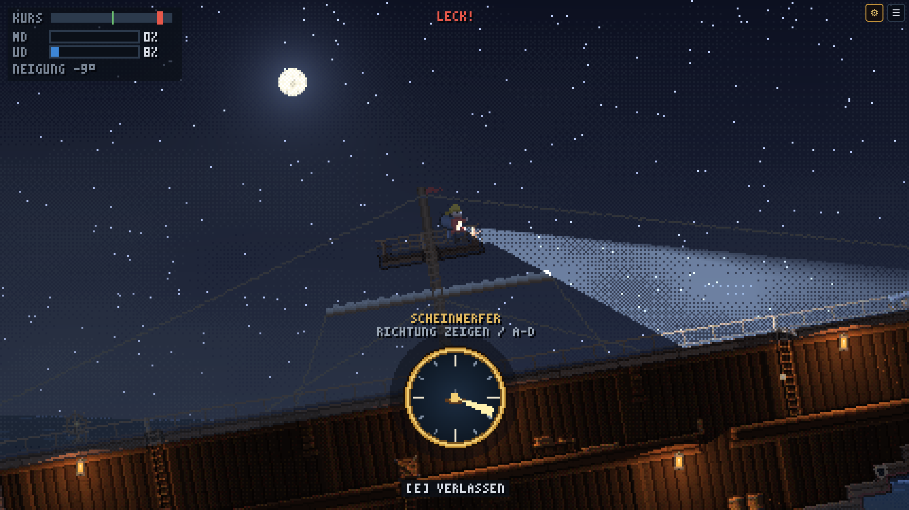

| Oberdeck | Unterdeck mit Leck | Laternenlicht |
|---|---|---|
| 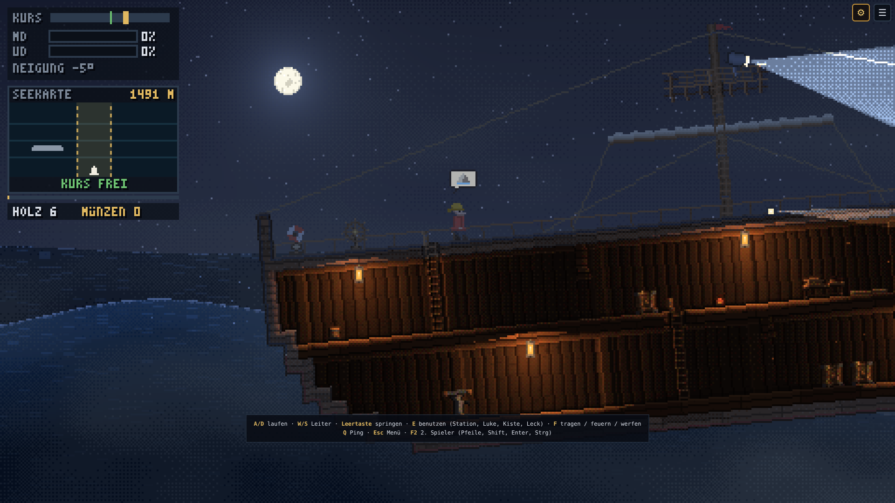 | 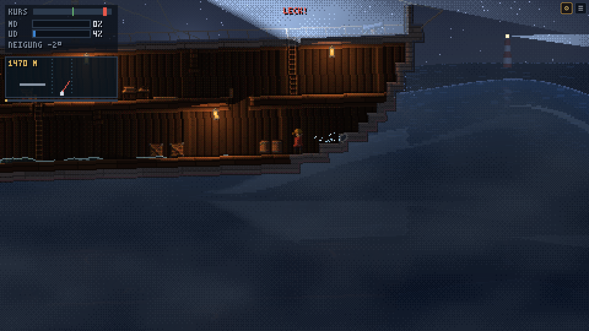 | 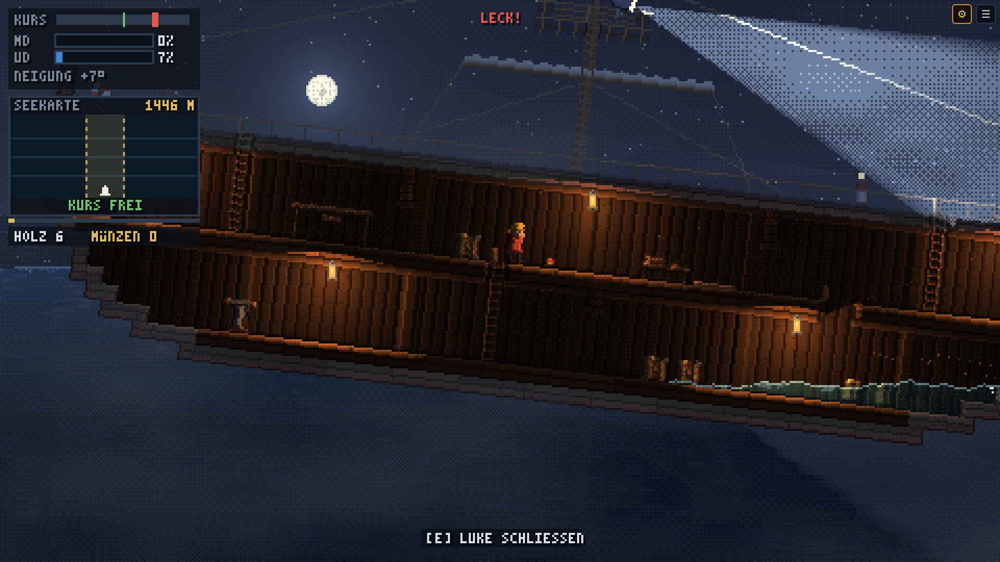 |
| **Debug-Overlay (F3)** | **Normal-Buffer (F7)** | **Touch (iPad-Viewport)** |
| 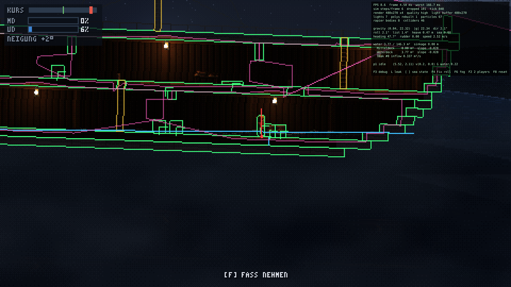 | 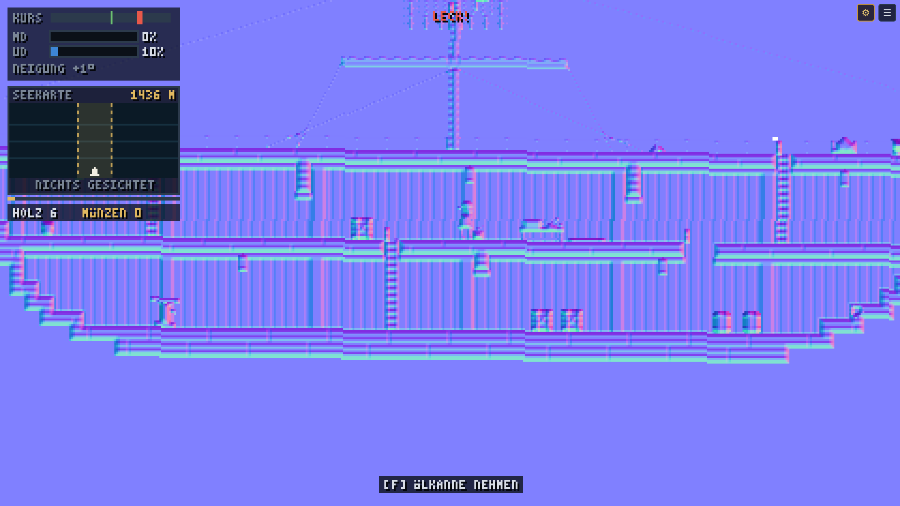 | 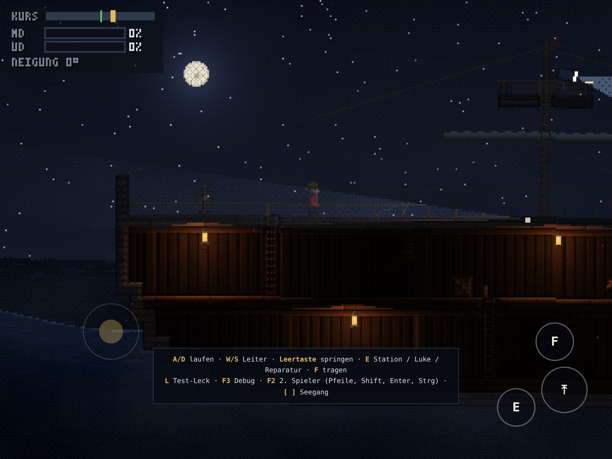 |
| **Steuerrad zum Drehen** | **Einstellungen (F9)** | **Lobby** |
| 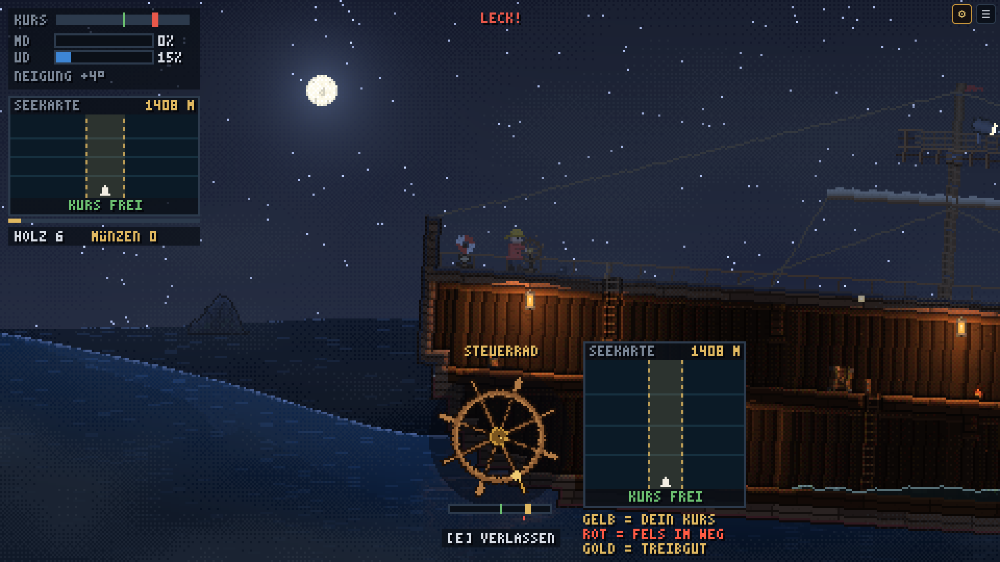 | 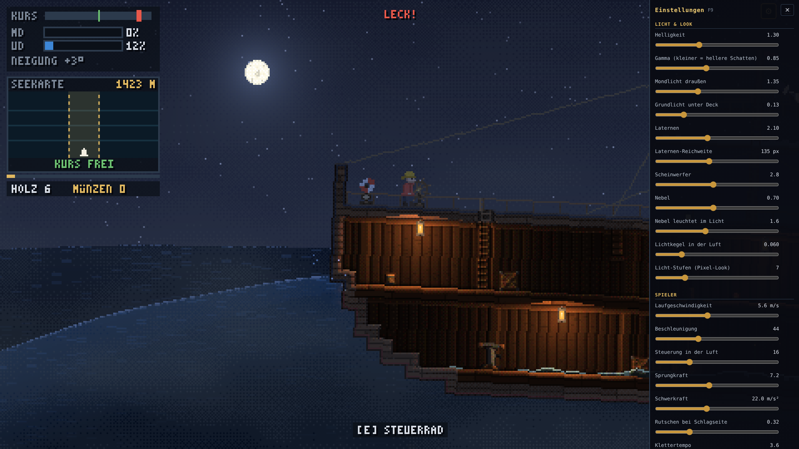 | 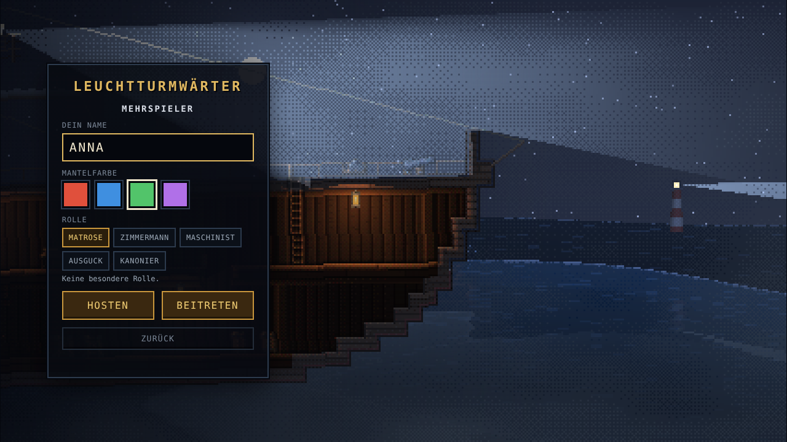 |
| **Online: zweiter Browser sieht „ANNA“** | **Scheinwerfer entdeckt Felsen (Seekarte links)** | **Krake am Bug, Kanone** |
| 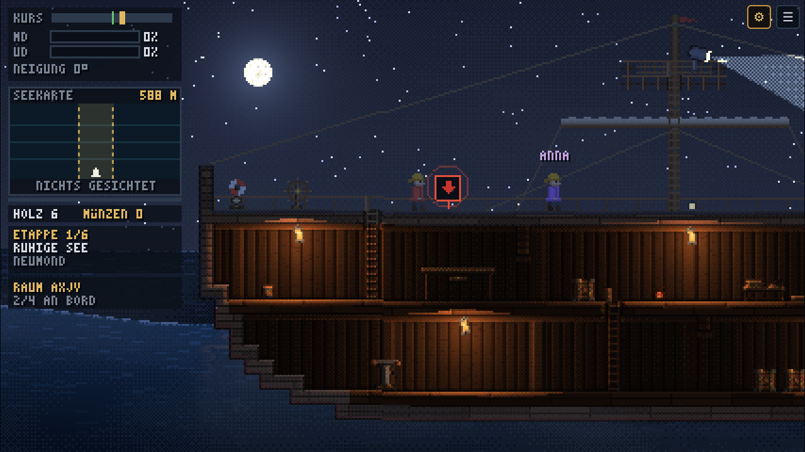 | 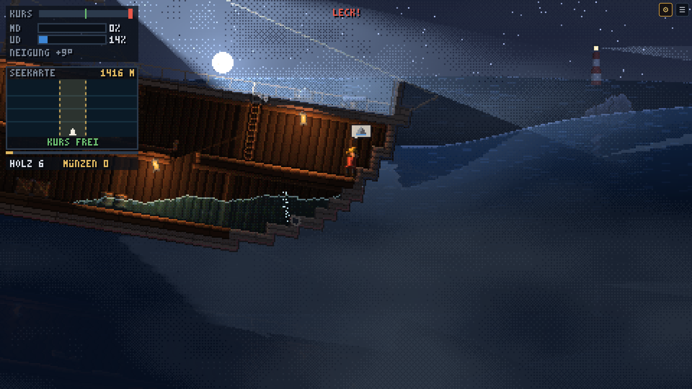 | 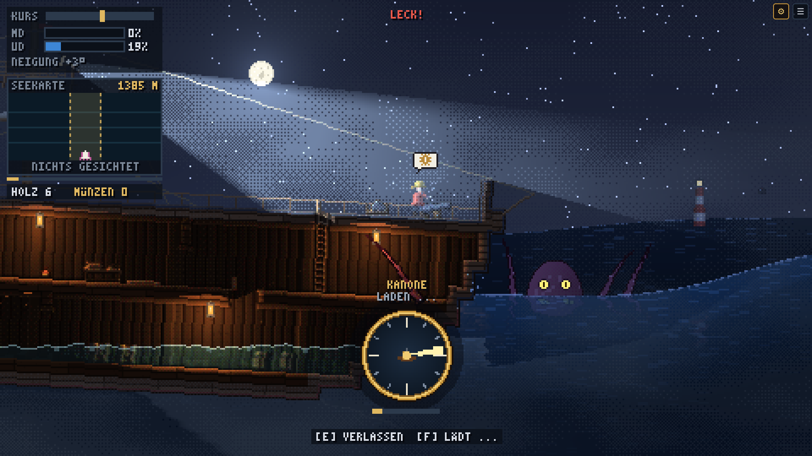 |
| **Leuchtturm erreicht** | **Seekarte am Steuerrad** | |
| 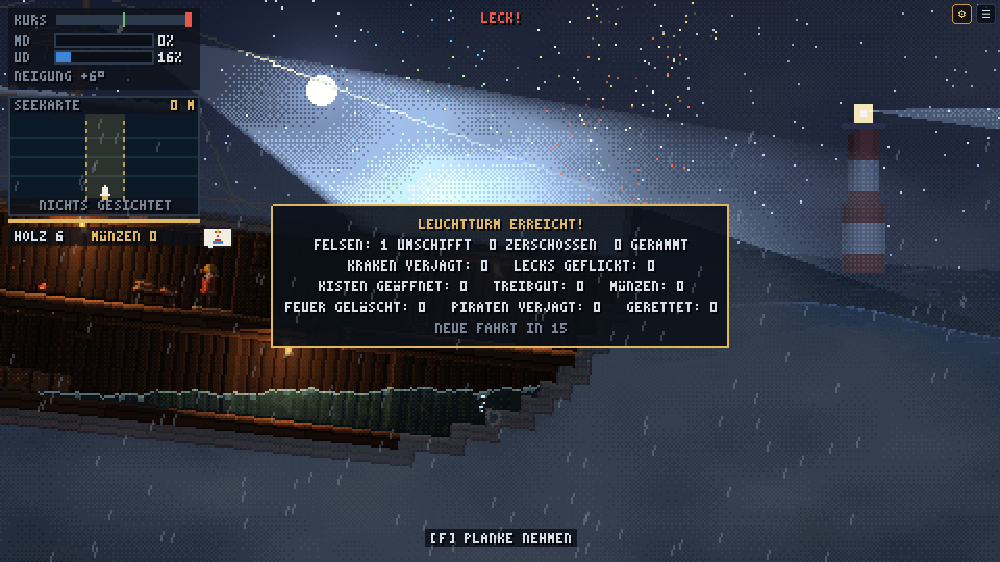 | 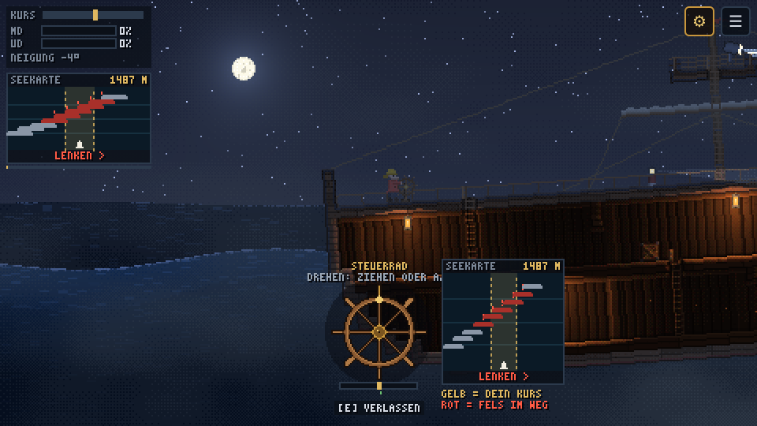 | |

---

## Start

Voraussetzung: Node.js 22 oder neuer.

```bash
npm install
npm run dev          # Spiel-Server (Port 2567) + Dev-Server auf http://localhost:5173 (auch im WLAN erreichbar)
```

Nach einem `git pull` mit neuen Paketen installiert `npm run dev` fehlende Abhängigkeiten selbst nach (sonst käme
„Failed to resolve import …“). Läuft der Dev-Server dabei schon, einmal neu starten.

- **iPad / Handy testen:** Rechner und Gerät ins gleiche WLAN, auf dem Gerät `http://<IP-deines-Rechners>:5173` öffnen
  (die IP zeigt Vite beim Start unter „Network“ an). Im Dev-Modus verbindet sich das Spiel automatisch mit dem
  Spiel-Server auf demselben Rechner – so könnt ihr schon im WLAN zu mehreren spielen, ohne etwas zu hosten.
- **Produktions-Build:** `npm run build`, dann `npm run preview` (Port 4173). Der Ordner `client/dist/` ist eine rein
  statische Seite und kann auf jedem Webspace / GitHub Pages / Netlify liegen.

Weitere Befehle:

| Befehl | Was es tut |
|---|---|
| `npm run dev:client` / `npm run dev:server` | nur den Client bzw. nur den Spiel-Server starten |
| `npm run start:server` | Spiel-Server ohne Datei-Überwachung (so läuft er auch beim Hoster) |
| `npm test` | Vitest für `shared/` (Simulation, Netzwerk-Logik), `client/` und `server/` (echte Verbindungen zum Raum) |
| `npm run typecheck` | `tsc --noEmit` für alle Pakete (`shared/` ohne DOM-Typen!) |
| `npm run build` | Typecheck + Vite-Build des Clients |
| `npm run assets` | Platzhalter-Grafiken neu erzeugen (von dir ersetzte Dateien bleiben erhalten) |
| `npm run verify` | Playwright: Server starten, Szenen-Screenshots nach `screenshots/`, Online-Runde mit 2 Browsern, Konsole prüfen, FPS messen |
| `node scripts/net-lag.mjs 200` | (bei laufendem `npm run dev`) Netzwerk-Gefühl mit 200 ms künstlicher Verzögerung messen |

### URL-Parameter (praktisch zum Testen, auch auf dem iPad ohne F-Tasten)

| Parameter | Wirkung |
|---|---|
| `?debug` | Debug-Overlay direkt an |
| `?p2` | zweiter lokaler Spieler direkt an |
| `?quality=high\|medium\|low` | Grafikstufe erzwingen (sonst automatisch, siehe unten) |
| `?sea=0.3` | Seegang (0 = Flaute, 0,75 = Standard, 1,3 = Sturm) |
| `?seed=42` | Zufalls-Seed der Simulation |
| `?tune` | Einstellungs-Panel direkt öffnen (auch im Produktions-Build) |
| `?h=300` | andere Ziel-Höhe der internen Auflösung |
| `?solo` | ohne Lobby direkt allein spielen |
| `?room=ABCD` | Einladung: Lobby mit eingetragenem Raumcode (so sieht der geteilte Link aus) |
| `?server=wss://…` | anderen Spiel-Server verwenden (z. B. Laptop über Cloudflare-Tunnel) |
| `?lag=150` | künstliche Verzögerung in ms (Round Trip) – zum Testen der Vorhersage |

---

## Steuerung

| Aktion | Tastatur (Spieler 1) | Spieler 2 (F2) | Touch |
|---|---|---|---|
| Laufen | A / D | ← / → | Stick links/rechts |
| Leiter rauf/runter | W / S | ↑ / ↓ | Stick hoch/runter |
| Springen | Leertaste | Shift rechts / Num 0 | Button ⤒ |
| Station betreten/verlassen, Luke öffnen/schließen, Leck reparieren, Planke holen | E | Enter / Num 1 | Button E |
| Objekt aufheben/ablegen, Planke an der Werkbank nehmen, **Kanone abfeuern** | F | Strg rechts / Num 2 / . | Button F |
| **Ping** (Stelle für alle markieren) | Rechtsklick / Mittelklick / Q (an der Maus) | – | Button ❗, dann auf die Stelle tippen (2× tippen = „hier bei mir“) |
| Menü / Ton aus | Esc / M | – | ☰ oben rechts |

Allein spielend steuern auch die Pfeiltasten Spieler 1.

**Stationen** (E): An jeder Station erscheint unten ein großes Bedienelement, das man mit Maus oder Finger benutzt
(oder weiter mit A/D):
- **Steuerrad:** am Rad entlang ziehen und drehen (±270°, die Messing-Speiche oben = Ruder mittig). Darunter Ruderlage und
  Kursabweichung (grün = auf Kurs).
- **Pumpe:** den Hebel rauf und runter ziehen (oder A und D **im Wechsel**). Jeder volle Hub pumpt Wasser ab.
- **Scheinwerfer:** auf der Kompass-Scheibe in die Richtung zeigen, in die der Kegel leuchten soll. Das Rollen des Schiffs
  wird ausgeglichen, solange man festhält.
- **Kanone:** zielen wie beim Scheinwerfer, **F feuert** (dann 2 s Nachladen, Balken unter der Scheibe).
- Neben dem Steuerrad erscheint groß die **Seekarte** (siehe unten).

E oder Leertaste verlässt die Station. Auf Touch-Geräten zeigen die Buttons E und F als Icon, was sie gerade tun würden
(Steuerrad, Pumpe, Luke, Hammer, Planke, Aufheben …). Ist ein Button grau, gibt es dort gerade nichts zu tun.

**Debug-Tasten**

| Taste | Wirkung |
|---|---|
| F3 | Debug-Overlay: FPS, Rapier-Collider, Leiter-Zonen, Schwerkraftvektor, Wasserstände/-flächen, Licht-Polygone |
| F7 | Zwischenbuffer anzeigen: Bild → Albedo → Normalen → Licht → Maske |
| L | Test-Leck erzeugen (abwechselnd Heck/Bug) |
| [ / ] | Seegang verringern / erhöhen |
| F4 | Rollwinkel fixieren (aus → +15° → −15° → +8°) – gut zum Testen des Rutschens |
| F6 | Nebel an/aus |
| F2 | zweiten lokalen Spieler hinzufügen/entfernen |
| F8 | Neustart |
| K / J / P | Krake sofort / Felsen direkt voraus / 200 m vorspulen |
| F9 | Einstellungen (auch über ⚙ oben rechts im Dev-Server) |
| Esc | Menü (Lobby / im Spiel: Raumcode, Einladungslink, Schiff verlassen) – auf Touch-Geräten ☰ oben rechts |

Online dürfen nur die Person, die das Schiff geöffnet hat (Host), Debug-Tasten und das Einstellungs-Panel benutzen; die
Werte gelten dann für alle an Bord. F2 (zweiter lokaler Spieler) gibt es online nicht – da hat jeder sein Gerät.

## So läuft eine Fahrt (Phase 4)

Ziel: das Schiff **1500 m bis zum Leuchtturm** bringen (Anzeige „820 M“ + Balken unter der Seekarte). Je näher man kommt,
desto stärker der **Sturm**: höhere Wellen, dichterer Nebel, Regen, Blitze. Ohne Crew sinkt das Schiff nach 3–5 Minuten.

- **Felsen im Nebel:** tauchen weit voraus auf. Wer am **Scheinwerfer** (Mastkorb) den Kegel knapp über den Horizont
  schwenkt, entdeckt sie und ruft „Felsen!“. Entdeckte Felsen erscheinen auf der **Seekarte** (HUD links oben und groß
  neben dem Steuerrad). Sie funktioniert wie ein Rennspiel von oben: Die **gelbe Spur** in der Mitte ist der Weg, den das
  Schiff in seiner jetzigen Richtung nimmt. Felsen in der Spur blinken **rot**, unten steht, wohin man lenken muss
  („< LENKEN“ / „LENKEN >“). Dreht man am **Steuerrad**, wandern die Felsen seitlich – rote aus der gelben Spur herauslenken,
  dann steht dort „KURS FREI“. Oder mit der **Kanone** zerschießen (nur Felsen im Weg). Ein Treffer am Bug reißt Lecks und
  wirft alle durcheinander. Eine Strömung dreht das Schiff langsam vom Kurs – wer gar nicht steuert, fährt langsamer und
  hört „Ruder!“ (auch, wenn ein entdeckter Felsen in der Spur liegt und niemand am Steuer steht).
- **Der Krake** taucht bei 30 % der Strecke auf (danach alle 450 m), nähert sich, packt den Bug und schlägt alle 7 s ein
  neues Leck. **Drei Kanonentreffer** verjagen ihn. Mit dem Scheinwerfer sieht man ihn früher, seine Augen leuchten.
- **Lecks:** Planke an der Werkbank holen (F), am Leck E (Hammer). Bis dahin pumpen. Ist das Unterdeck fast voll, sinkt
  das Schiff (Neustart nach 5 s).
- **Ohne Sprache:** Automatische Zurufe (Sprechblasen) – „Ruder!“ wenn der Kurs abdriftet und keiner steuert, „Wasser!“,
  „Felsen!“, „Krake!“, „Land in Sicht!“. Dazu **Pings**: Der Ping bekommt seine Bedeutung von der Stelle (auf ein Leck =
  Leck-Symbol, auf eine Station = „hier wird jemand gebraucht“, aufs Meer = Gefahr, sonst Pfeil „hierher“). Pings außerhalb
  des Bildschirms kleben mit Pfeil am Rand.
- **Ankunft:** Feuerwerk, Nebelhorn, das Schiff stoppt vor der Leuchtturm-Insel, Bilanz (Felsen umschifft / zerschossen /
  gerammt, Krake verjagt, Lecks geflickt), nach 15 s geht es von vorn los.

Gute Rollenverteilung zu viert: Steuerrad, Scheinwerfer, Kanone, „Zimmermann“ (Lecks + Pumpe).

Alle Werte (Strecke, Felsen-Abstand, Krake, Kanone, Sturm …) stehen im Einstellungs-Panel unter „Fahrt & Gefahren“.

### Einmal durchspielen (Testablauf)
1. **L** drücken → „LECK!“, die nächste Figur ruft per Sprechblase, im Unterdeck spritzt Wasser herein.
2. Wasser sammelt sich auf der tiefen Seite, Schlagseite und Tiefgang nehmen zu (HUD links oben: „UD“ und „NEIGUNG“).
3. Leiter runter zur **Pumpe** (Unterdeck, Heck), E, dann A/D im Wechsel → Wasserstand sinkt.
4. Zur **Werkbank** (Mitteldeck), F → Planke in den Händen (man wird langsamer).
5. Zum Leck, E → Reparatur-Balken; danach ist das Loch geflickt und es läuft kein Wasser mehr nach.
6. Läuft das Unterdeck voll (42 % des ganzen Rumpfs), sinkt das Schiff und das Spiel startet nach 5 s neu.

---

## Werte live einstellen (F9 / ⚙)

Das Einstellungs-Panel ändert Spiel- und Grafikwerte **während des Spiels**: Helligkeit, Gamma, Mondlicht, Grundlicht unter
Deck, Laternen, Scheinwerfer, Nebel, Licht-Stufen, Laufgeschwindigkeit, Beschleunigung, Sprungkraft, Schwerkraft, Rutschen,
Seegang, Rollverhalten, Leck-Einstrom, Pumpe und mehr.

- Geänderte Werte werden **gold** markiert, ↺ setzt einen Wert zurück.
- Änderungen merkt sich das Gerät (localStorage), auch nach dem Neuladen.
- **„Als Standard speichern“** schreibt alle Werte über den Dev-Server (`npm run dev`) in
  `shared/src/tuning.json` (Spielwerte) und `client/src/look.json` (Grafik). Die Seite lädt dann mit den neuen
  Standardwerten neu – committen, fertig. Das funktioniert auch vom iPad aus, wenn es per WLAN auf den Dev-Server zugreift.
- Ohne Dev-Server (Produktions-Build) gibt es stattdessen „JSON kopieren“.
- Die Spielwerte laufen als Befehl durch die Simulation (`{ type: 'tune' }`). Online schickt der Host sie an den Server, der
  sie an alle Geräte verteilt – alle spielen mit denselben Werten. Wer ein Schiff öffnet, bringt seine lokal eingestellten
  Werte mit.

---

## Online spielen

1. Alle öffnen das Spiel (im WLAN über den Dev-Server oder über die Vercel-Seite, sobald der Server gehostet ist).
2. In der Lobby **Namen** eingeben und eine **Mantelfarbe** wählen (ist sie schon vergeben, bekommt man die nächste freie).
3. Eine Person tippt **„Neues Schiff“** → oben links steht der **Raumcode** (4 Buchstaben, z. B. `KJMX`).
4. Die anderen tippen den Code ein und **„An Bord“** – oder öffnen den Einladungslink (Menü → „Einladungslink teilen“,
   auf dem iPad über das Teilen-Menü, z. B. AirDrop).
5. Maximal 4 Personen pro Schiff. Über den Köpfen der anderen stehen ihre Namen.

**Verbindung weg?** Das Spiel verbindet sich automatisch neu (HUD: „VERBINDUNG WEG – VERBINDE NEU …“). Die Figur bleibt
so lange halb durchsichtig an Bord. Auch **Neuladen der Seite** setzt einen wieder auf denselben Platz (45 s Zeit).

**Wie es funktioniert (kurz):** Der Server rechnet das Spiel (dieselbe `Simulation` wie im Browser) mit 60 Hz und schickt
20-mal pro Sekunde den kompletten Zustand. Jedes Gerät rechnet trotzdem selbst weiter und wendet die eigenen Eingaben sofort
an (**Client-Side-Prediction**); kommt der Server-Zustand, springt es dorthin zurück und rechnet die noch nicht bestätigten
Eingaben neu (**Reconciliation**). Kleine Abweichungen werden nicht als Ruckler, sondern als kurzes Nachgleiten gezeigt.
Details in `DECISIONS.md` („Phase 3“).

---

## Server hosten

Der **Client** liegt schon auf Vercel (statische Seite). Der **Spiel-Server** braucht einen Dienst, auf dem ein
Node-Prozess dauerhaft läuft und WebSockets annimmt – Vercel selbst kann das nicht (nur kurzlebige Funktionen). Weil die
Vercel-Seite per HTTPS läuft, muss der Server per **`wss://`** (also mit TLS) erreichbar sein.

### Empfehlung: Fly.io (ca. 2–4 $/Monat, eher weniger)
Die Maschine schläft, wenn niemand verbunden ist, und wacht beim nächsten Besuch in 1–2 s auf – bezahlt wird nur die Zeit,
in der gespielt wird. Alles Nötige liegt im Repo (`server/Dockerfile`, `fly.toml`).

1. Konto auf [fly.io](https://fly.io) anlegen (Kreditkarte nötig) und `flyctl` installieren
   (Mac: `brew install flyctl`), dann `fly auth login`.
2. In `fly.toml` den App-Namen ändern (muss weltweit eindeutig sein, z. B. `leuchtturm-deinname`).
3. Im Repo-Ordner: `fly launch --no-deploy --copy-config` (Fragen mit den Werten aus `fly.toml` bestätigen), dann
   **`fly deploy --ha=false`**. Wichtig: genau **eine** Maschine – die Räume liegen im Arbeitsspeicher, bei zwei Maschinen
   fände man den Raumcode nur auf einer davon. (`fly scale count 1` korrigiert das notfalls.)
4. Test: `https://<app-name>.fly.dev/` im Browser zeigt „Colyseus 0.18.…“ – dann läuft er.
5. In **Vercel** → Project → Settings → Environment Variables: `VITE_SERVER_URL` = `wss://<app-name>.fly.dev`
   (für Production **und** Preview), dann neu deployen. Fertig – die Lobby zeigt jetzt „Neues Schiff“.

Updates: nach Änderungen an `shared/` oder `server/` einfach wieder `fly deploy --ha=false`. Client und Server sollten
denselben Stand haben; passt die Protokoll-Version nicht, sagt die Lobby „Version passt nicht – bitte Seite neu laden“.

### Alternativen
| Option | Kosten | Hinweise |
|---|---|---|
| **Eigener Laptop + Cloudflare-Tunnel** | 0 € | `npm run start:server`, dann `cloudflared tunnel --url http://localhost:2567` → liefert eine `https://…trycloudflare.com`-Adresse; die Vercel-Seite mit `?server=wss://…trycloudflare.com` öffnen. Ideal zum Testen. |
| **Render** (Free) | 0 € | Docker-Deploy mit `server/Dockerfile`. Schläft nach 15 min ohne Verkehr ein, Aufwachen dauert ~1 min. |
| **Hetzner Cloud** (CX23) | ca. 4 €/Monat | Viel Leistung, nah an Köln, aber selbst verwalten: Docker, Domain, Caddy für TLS. |
| **Railway** | ca. 5 $/Monat | Docker-Deploy, bequem. |

**Schul-WLAN:** Viele Schul-Netze verbieten Verbindungen zwischen Geräten (Client-Isolation). Dann klappt „Laptop als
Server“ dort nicht – ein gehosteter Server schon.

---

## Projektstruktur

```
shared/   Simulation: Physik (Rapier2D), Regeln, State – kein DOM, kein Rendering
  src/layout/shipMap.ts      das Schiff als ASCII-Karte (hier umbauen!)
  src/tuning.json            alle Spielwerte (vom Einstellungs-Panel gespeichert)
  src/layout/parseLayout.ts  leitet Collider, Licht-Occluder, Leitern, Luken, Wasserräume ab
  src/simulation.ts          Simulation-Klasse: sim.step(inputs, dt, commands) → sim.state
  src/ship.ts, sea.ts        Wellenfunktion, Rollen/Heave, rotierte Schwerkraft
  src/water.ts               Wasser pro Kompartiment (Füllstand, Neigung, Fluss durch Luken)
  src/fixedStepper.ts        fester 60-Hz-Timestep mit Accumulator
client/   Rendering (PixiJS v8), Input, HUD
  src/render/GameRenderer.ts Low-Res-Pässe + Upscaling
  src/render/lighting/       Sichtbarkeits-Polygone + Light-System
  src/render/shaders.ts      alle GLSL-Shader (Licht, Composite/Nebel, Meer, Rumpfwasser)
  src/render/ShipView.ts     alles auf dem Schiff (inkl. schwingender Laternen als Deko-Physik)
  src/look.json              Grafikwerte: Helligkeit, Licht, Nebel (vom Einstellungs-Panel gespeichert)
  src/ui/StationWidget.ts    Steuerrad, Pumpenhebel, Kompass-Scheibe
  src/ui/TuningPanel.ts      Einstellungs-Panel (F9)
  public/assets/             Platzhalter-Grafiken (+ README zum Austausch gegen Aseprite-Exporte)
  src/net/                   Netzwerk: Protokoll, ShipHost (Server-Logik), Predictor (Vorhersage im Client)
server/   Colyseus-Server: ShipRoom (ein Raum = ein Schiff), Dockerfile
  src/ShipRoom.ts            Raumcode, 60-Hz-Simulation, Snapshots, Reconnect, Host-Rechte
client/src/net/              Verbindung (NetLink) und Server-Adresse (config.ts)
client/src/ui/Lobby.ts       Lobby und Menü
scripts/  Asset-Generator, Browser-Verifikation
```

Wichtige Prinzipien: Die Simulation bekommt nur **Inputs als Daten** und gibt **State als Daten** heraus. Das Schiff ist
kein Physik-Body: Innen wird im Schiffs-Koordinatensystem simuliert und stattdessen die **Schwerkraft gegen den Rollwinkel
gedreht**. Beim Rendern dreht sich der Schiffs-Container, das Meer liegt im Weltkoordinatensystem. Alle Entscheidungen mit
Begründung stehen in [`DECISIONS.md`](DECISIONS.md), der Arbeitsplan in [`PLAN.md`](PLAN.md).

---

## Was fertig ist

**Phase 1 – spielbares Schiff**
- Schiff mit 3 Decks + Mastkorb, 4 Leitern, 5 Luken (davon eine Frachtluke ohne Leiter), Schotten mit Türen
- Wellen (Summe von 4 Sinuswellen) → Rollen bis ±15° + Heave; Schwerkraft im Schiffs-Frame rotiert, Heave-Beschleunigung
  verändert das Gewicht
- Spieler: Laufen, Springen (Coyote-Time + Sprung-Puffer), Klettern, durch offene Luken klettern/fallen, Tragen (verlangsamt),
  Schwimmen bei hohem Wasserstand, Mann-über-Bord mit Respawn
- Spürbares, aber steuerbares Rutschen bei Schlagseite (bei 15° ca. 1,8 m/s Drift, Laufen 5,6 m/s)
- Kisten, Fässer, Planken rutschen und kippen, schwimmen auf Wasser
- Stationen: Steuerrad (Kurs + Rollverhalten + Krängung), Pumpe, Scheinwerfer, Werkstatt, Kanone (nur Zielen)
- Test-Leck (L), Einstrom abhängig von der Tiefe unter der echten Wasserlinie, Reparatur mit Planke
- Wasser pro Kompartiment, neigt sich (mit Schwappen), fließt durch offene Luken, erzeugt Schlagseite und Tiefgang;
  Sinken → Neustart
- Kamera folgt sanft und pixelgenau; HUD mit Kurs, Wasserständen, Neigung, Stations-UI, Kontext-Hinweisen
- Automatische Sprechblasen („Leck!“, „Planke nötig!“) als Basis für Kommunikation ohne Sprache
- Lokaler 2-Spieler-Modus (F2), Touch-Steuerung, Debug-Overlay (F3)

**Phase 2 – Look**
- Interne Auflösung ~480×270, ganzzahlig mit Nearest-Neighbor hochskaliert
- Lighting-Pipeline: Albedo-, Normalen-, Masken-, Licht- und Composite-Pass; Sichtbarkeits-Polygone gegen die Schiffswände,
  Normal Maps (`x.png` + `x_n.png`), posterisiertes Licht mit Bayer-Dithering (bleibt pixelig)
- 5 schwingende Laternen (Pendel-Deko-Physik im Client, folgen der Schräglage) mit Flackern und harten Schatten
- Scheinwerfer im Mastkorb mit Kegel, hellt Nebel und Takelage auf
- Animierter Pixel-Nebel (Value-Noise, quantisiert), wird vom Licht-Buffer aufgehellt; Mond, Sterne, Leuchtturm mit
  rotierendem Strahl am Horizont
- Meer mit Wellen, Schaumkrone, Glitzern und Reflexions-Andeutung; Wasser im Rumpf mit Wellen-Shader
- Partikel: Gischt an Bug/Heck, Wasserstrahl bzw. Blasen am Leck, Pumpen-Schwall, Spritzer bei Mann über Bord
- Qualitätsstufen mit Auto-Fallback (siehe Performance)

**Phase 3 – Online**
- Colyseus-Server (`server/`), der dieselbe `Simulation` autoritativ mit 60 Hz rechnet; 20 Snapshots pro Sekunde
- Raumcodes aus 4 Buchstaben, max. 4 Spieler, Lobby mit Name + Mantelfarbe, Einladungslink, Menü (Esc / ☰)
- Client-Side-Prediction + Reconciliation, Korrekturen werden weich ausgeblendet; Jitter-Puffer auf dem Server
- Automatisches Neuverbinden und Weiterspielen nach dem Neuladen der Seite (45 s), getrennte Spieler halb durchsichtig
- Host-Rechte: Debug-Tasten und Einstellungs-Panel wirken für alle, Werte werden an alle Geräte verteilt
- Namensschilder, Raumcode + Besatzung im HUD, Verbindungsstatus, Netzwerk-Werte im Debug-Overlay (F3)
- Deploy-Dateien für Fly.io (Docker), Tests mit echten Verbindungen

**Phase 4 – Spielinhalt, Kommunikation, Sound**
- Fahrt zum Leuchtturm mit wachsendem Sturm (Wellen, Nebel, Regen, Blitze), Leuchtturm wird größer, Ankunft mit Bilanz
- Felsen im Nebel mit seitlicher Position, Scheinwerfer entdeckt sie, Seekarte, Ausweichen per Steuerrad, Rammen = Lecks
- Kanone mit Kugeln (ballistisch), zerschießt Felsen im Weg und verjagt den Kraken (3 Treffer)
- Krake: taucht auf, nähert sich, packt den Bug, schlägt Lecks
- Pings mit Bedeutung aus dem Ort, für alle sichtbar (auch online, Ratenlimit auf dem Server)
- Automatische Zurufe: Ruder, Wasser, Felsen, Krake, Land in Sicht
- 3 zusätzliche Leckstellen (Bug, Boden, Mitteldeck)
- Platzhalter-Sounds (41 synthetisierte WAVs, austauschbar) mit Web-Audio-Engine: Entfernung/Stereo, gedämpft unter
  Deck, Loops für Meer/Wind/Regen/Leck, Lautstärke im Menü
- Snapshots binär statt msgpack: ~0,8 KB statt ~3,5 KB (≈ 16 KB/s pro Gerät)

## Was (noch) nicht fertig ist
- Musik (kommt von dir), echte Sounds (Platzhalter sind austauschbar – siehe `client/public/assets/README.md`)
- Echte Grafiken (alles Platzhalter, aber austauschbar)
- Weitere Gefahren / Abwechslung (siehe Vorschlag Phase 5), Schwierigkeitsstufen, Statistiken über Runden hinweg

## Bekannte Probleme
- **Safari/WebKit nicht automatisch getestet:** In der Build-Umgebung konnte WebKit nicht installiert werden. Das
  Verifikationsskript testet WebKit automatisch mit, sobald `npx playwright install webkit` lokal gelaufen ist.
- **FPS auf echten Geräten unbekannt:** Headless-Chromium rendert hier per Software (SwiftShader), siehe unten.
- **Pixelkriechen beim Rollen:** Gedrehte Pixel-Art mit Nearest-Sampling „flimmert“ leicht an Kanten. Bewusst so (kein
  Weichzeichnen); wer es ruhiger will, kann später das Schiff erst unrotiert rendern und dann als Ganzes drehen.
- Getragene Objekte haben keine Kollision (schweben über dem Kopf, können optisch in Decken ragen).
- Die Pumpe leert nur das Unterdeck; Wasser im Mitteldeck läuft über offene Luken dorthin. Wasser kann nicht nach oben
  gedrückt werden (keine Druckmodellierung).
- Im Mastkorb ist die Reling nur 1 Tile hoch – man kann herunterspringen (landet an Deck).
- Zwei lokale Spieler teilen sich eine Kamera (Mittelpunkt); sind sie weit auseinander, ist einer am Rand.
- Der Rollwinkel ist absichtlich kräftig; bei empfindlichen Spielern kann das auf Dauer unangenehm sein (Seegang mit `[`
  oder `?sea=` reduzieren).
- Sehr selten können an exakten Tile-Ecken einzelne Lichtpixel durch Wände „durchblitzen“.
- **Online: andere Spieler werden vorausberechnet** (sie „machen weiter, was sie zuletzt taten“). Ändern sie plötzlich die
  Richtung, gleitet ihre Figur bei hoher Verzögerung kurz zurück. Im WLAN (< 50 ms) kaum sichtbar.
- Online kostet ein Snapshot ca. 0,8 KB (20/s → ~16 KB/s pro Gerät).
- **Sounds sind nicht probegehört:** Sie sind synthetisiert und nur technisch geprüft (Pegel, Loops nahtlos). Auf dem
  iPad: Ist der Stumm-Schalter an, spielt Safari keinen Web-Audio-Ton.
- Die Seekarte rechnet mit der aktuellen Fahrtrichtung. Die Strömung dreht das Schiff langsam weiter – ein Felsen kann also
  nach ein paar Sekunden doch rot werden, wenn niemand steuert. Das ist Absicht (Aufgabe für das Steuerrad).
- Server-Neustart (z. B. neues Deploy) beendet alle laufenden Schiffe.

---

## Performance

Gemessen mit `npm run verify` in der Cloud-Build-Umgebung: **Headless-Chromium ohne GPU** – WebGL läuft dort über
SwiftShader, also komplett auf 4 CPU-Kernen. Diese Zahlen sind eine Untergrenze und **nicht** auf echte Geräte übertragbar.

| Messung (1920×1080, intern 480×270 ×4) | FPS |
|---|---|
| leere WebGL-Seite (nur `clear`, `client/public/bench/empty.html`) als Vergleich | 47 |
| Spiel, Qualität **high** (WebGL-Upscaling) | 9,2 |
| Spiel, Qualität **medium** (CSS-Upscaling) | 24,5 |
| Spiel, Qualität **low** (CSS-Upscaling + halber Light-Buffer) | 25,6 |
| Spiel bei 480×270 ×1 (ohne Upscaling) | ~37 |

CPU-Anteil (JavaScript) im selben Browser: **2,6 ms pro Frame** inkl. Simulation (mit Phase 4: 2,8 ms Median), davon ein 60-Hz-Physik-Step **0,13 ms**;
ein kompletter Neuaufbau aller 6 Licht-Polygone **0,84 ms** (wird gecacht, solange Lichter stillstehen). Der Rest ist
Software-Rasterisierung von 5 Low-Res-Pässen à 130 000 Pixel plus Upscaling – genau das, was eine echte GPU (auch die eines
alten iPads) nebenbei erledigt.

**Light-Buffer-Auflösung:** volle interne Auflösung (480×270). Das sind 130 000 Pixel – auf GPUs vernachlässigbar und
nötig für pixelgenaue Schattenkanten. Fällt die Framerate trotzdem 3 s lang unter 50 fps, schaltet das Spiel automatisch
erst auf CSS-Upscaling (`medium`), dann auf einen Light-Buffer mit halber Auflösung (`low`). Die aktuelle Stufe steht im
Debug-Overlay (F3 bzw. `?debug`).

---

## Was du manuell testen musst
- [ ] **iPad + Safari:** Seite per WLAN öffnen, `?debug` anhängen → FPS ablesen (Ziel: stabil 60, Qualität bleibt „high“).
      Falls die Stufe auf medium/low fällt: Ist das Bild trotzdem pixelscharf (CSS `image-rendering: pixelated`)?
- [ ] **Safari am Mac** und **Chrome auf den Schul-Laptops** (1366×768 → intern 455×256 ×3): Darstellung, FPS, Konsole.
- [ ] **Touch:** Stick (laufen, Leiter hoch/runter), Buttons ⤒/E/F mit Kontext-Icons, Steuerrad mit dem Finger drehen,
      Pumpenhebel ziehen, Scheinwerfer-Scheibe. **Doppeltippen auf einen Button darf nicht mehr zoomen** (iOS ignoriert
      `user-scalable=no`, deshalb werden die Touch-Gesten jetzt per Skript blockiert – nur auf einem echten iPad prüfbar).
      Mehrere Finger gleichzeitig (Stick + Springen)? Lässt sich das Einstellungs-Panel noch scrollen?
- [ ] **Gefühl:** Rutschen bei Schlagseite (F4 fixiert ±15°), Sprunghöhe, Tempo beim Tragen, Pumpen vs. Leck-Einstrom –
      alles im Einstellungs-Panel (F9) live justieren und als Standard speichern.
- [ ] **Licht:** Schatten der Laternen an Schotten/Decken, Scheinwerfer im Nebel (F6 schaltet den Nebel zum Vergleich ab).
- [ ] **Zwei Spieler lokal** (F2): beide Steuerungen gleichzeitig, Kamera.
- [ ] Optional: `npx playwright install webkit` und `npm run verify` für die WebKit-Screenshots.
- [ ] **Online im WLAN:** `npm run dev`, Mac + iPad (+ Handy) in einen Raum. Fühlt sich die eigene Figur genauso direkt an
      wie allein? Sehen die anderen flüssig aus? (F3 zeigt rtt, pending, Korrektur in cm.)
- [ ] **Verbindung weg:** auf dem iPad kurz WLAN aus und wieder an → Figur wird halb durchsichtig, danach geht es weiter.
      Seite neu laden → wieder auf demselben Platz.
- [ ] **Einladungslink** über das Teilen-Menü (AirDrop/Nachrichten) öffnen → Lobby mit eingetragenem Code.
- [ ] **Nach dem Hosten:** Vercel-Seite (HTTPS) mit Fly-Server, 4 Geräte gleichzeitig, auch im Schul-WLAN.
- [ ] **Eine ganze Fahrt zu zweit/viert:** Ist es schaffbar? Zu leicht/zu schwer? (Felsen-Abstand, Krake, Leck-Einstrom
      im Panel unter „Fahrt & Gefahren“ / „Spielregeln“ justieren.) Mit P lässt sich vorspulen, K holt den Kraken.
- [ ] **Seekarte:** Versteht man ohne Erklärung, was rot bedeutet und wohin man steuern muss?
- [ ] **Pings:** Rechtsklick am Mac, Ping-Button auf dem iPad (antippen, dann Stelle antippen). Sieht man sie gut?
- [ ] **Sounds anhören** (Ton an, Stumm-Schalter am iPad aus): Was bleibt, was ersetzt du? Lautstärke im Menü (Esc / ☰).

---

## Vorschlag für Phase 5

1. **Musik** von dir einbauen (ruhiger Loop, der mit dem Sturm intensiver wird – zwei Stems übereinander blenden).
2. **Abwechslung:** Nebelbänke ohne Sicht, Treibgut (Planken auffischen), ein Sturmbrecher, der das Deck flutet, Blitz
   schlägt in den Mast (Feuer löschen).
3. **Schwierigkeitsstufen** für den Raum (Strecke, Felsen-Dichte, Krake) und eine kleine **Bestenliste** pro Raum.
4. **Echte Grafiken** schrittweise (Spielerfigur, Krake, Stationen) – das Format bleibt gleich.
5. **Leistung auf alten iPads** messen und, falls nötig, Partikel/Regen nach Qualitätsstufe reduzieren.
